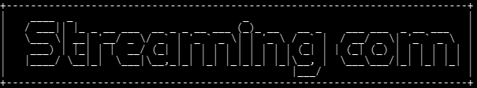

<p align="center">
	
</p>

# SC Downloader (Electron)

La stessa app di `python/StreamingCommunity_api`, riscritta in Node dentro Electron: un programma Windows che si installa e parte con un doppio clic, senza Python né FFmpeg da installare.

Puoi guardare e scaricare film e serie TV di StreamingCommunity e gli anime di AnimeUnity. I download si caricano sul NAS, puoi cercare torrent con Jackett e qBittorrent e usare l'app dal telefono. L'interfaccia è la stessa pagina web della versione Python, e il server risponde alle stesse chiamate `/api/...`.

## Installazione

Apri `dist\SC Downloader Setup 1.0.0.exe` e segui l'installazione. Non servono permessi di amministratore: il programma va nella cartella dell'utente e crea il collegamento sul desktop e nel menu Start.

Senza installare, puoi avviare direttamente `dist\win-unpacked\SC Downloader.exe`.

La prima volta Windows SmartScreen può avvisare che l'app non è firmata: scegli **Ulteriori informazioni → Esegui comunque**. Poi Windows chiede se consentire l'accesso alla rete: scegli **Reti private**, serve per l'uso dal telefono.

## Dove salva i file

| Cosa | Dove |
| --- | --- |
| Video scaricati | `Video\SC Downloader` (film, cartelle delle serie, `anime\`), si cambia nelle impostazioni, scheda Download |
| Impostazioni, coda dei download, cronologia, posizioni dei video | `%APPDATA%\SC Downloader` |
| Segmenti dei download da riprendere | `%APPDATA%\SC Downloader\tmp\segments` |
| Errori | `%APPDATA%\SC Downloader\logs\errori.log` |

La cartella dei video può essere anche su un altro disco: il video viene preparato in `%APPDATA%` e poi copiato lì, prendendo il suo nome solo a copia finita. Cambiarla vale per i prossimi download, quelli già fatti restano dove sono.

Le password del NAS e di qBittorrent sono cifrate da Windows (la stessa protezione del Gestore credenziali). La variabile `SC_NAS_PASSWORD` resta valida come nella versione Python.

## Sottotitoli

I sottotitoli del sito finiscono dentro il video. Con l'audio italiano si vede da sola la traccia forzata, quella delle battute in lingua straniera di un film doppiato; con l'audio straniero si vede l'italiano completo. Un titolo doppiato senza traccia forzata non riceve nessuna traccia nel file, perché il player mostrerebbe tutte le battute. Nello streaming dell'app tutte le tracce restano nel menu del player.

## Chiusura

Se nessun download è in corso, chiudere la finestra chiude il programma. Se invece c'è un download o un caricamento sul NAS, il programma resta attivo con l'icona vicino all'orologio e si chiude da solo quando ha finito. Dall'icona puoi riaprire la finestra, oppure uscire subito: in quel caso il download riprende al prossimo avvio dai segmenti già salvati.

## Telefono

Con l'app aperta sul PC, ogni dispositivo dello stesso Wi-Fi può usarla su `http://<indirizzo del pc>:8770`. Indirizzo e QR code sono nelle impostazioni, scheda Telefono. I dispositivi fuori dalla rete di casa vengono rifiutati.

## Torrent

Funziona come nella versione Python: Jackett e la Web UI di qBittorrent si impostano nelle impostazioni, scheda Torrent. I plugin di ricerca di qBittorrent sono script Python, quindi per usarli serve Python installato sul PC, lo stesso che serve a qBittorrent per la sua ricerca. FFmpeg e ffprobe invece sono già inclusi.

## Sviluppo

Serve Node 24 (su questo PC è in `%LOCALAPPDATA%\Programs\node-v24.21.0-win-x64`).

```bash
npm install
node node_modules/electron/install.js
```

```bash
npm start
```

```bash
npm test
```

```bash
npm run dist
```

- `npm start` apre l'app in Electron.
- `npm run server` avvia solo il server, da aprire nel browser su `http://127.0.0.1:8765`. I dati vanno in `data/` dentro il progetto.
- `npm test` scarica un video HLS cifrato generato in locale (video e audio separati come vixcloud) e controlla unione, sottotitoli, annullamento, ripresa, copia su un altro disco e streaming, poi il formato dei dati del sito, i nomi dei file sul NAS e i messaggi di errore.
- `npm run dist` crea l'installer in `dist/`.

Le variabili `SC_DATA_DIR` e `SC_VIDEOS_DIR` cambiano le cartelle dei dati e dei video, utili per provare senza toccare quelli veri.

### Corrispondenza con la versione Python

| Python | Electron |
| --- | --- |
| `Src/Api/*.py` | `src/api/*.js` |
| `Src/Lib/FFmpeg/my_m3u8.py` | `src/lib/downloader.js`, `src/lib/m3u8.js`, `src/lib/ffmpeg.js` |
| `Src/Lib/Nas/nas.py` (paramiko, keyring) | `src/lib/nas.js` (ssh2, cifratura di Windows) |
| `Src/Lib/Torrent/*.py` | `src/lib/torrent/*.js` |
| `Src/Gui/server.py` | `src/gui/server.js`, `src/gui/downloads.js` |
| `Src/Gui/*.py` (consigli, anime, player, telefono, torrent) | `src/gui/*.js` |
| `Src/Util/*.py` | `src/util/*.js` |
| `Src/Gui/instance.py`, finestra di Edge/Chrome | `main.js` (una sola istanza, finestra Electron, icona vicino all'orologio) |
| `Src/Gui/web/` | `web/` (identica) |

Se il sito cambia e si corregge la versione Python, la stessa correzione va fatta nel file corrispondente qui.
